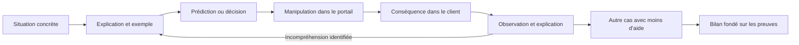

# Contrat du moteur pédagogique V2

Statut au 2 novembre 2026 : le lot 1 est implémenté et vérifié comme logiciel. Le test d’apprentissage avec Romain reste à faire. Ce contrat décrit aussi les lots suivants : la création et la publication d’une application ne font pas partie du mini-parcours livré.

## Direction du produit

Le parcours enseigne à déployer et exploiter des applications, puis à développer des fonctions IA, des RAG et des outils MCP. AZ-900 fournit une carte de notions à mobiliser progressivement. La structure des chapitres suit des problèmes applicatifs concrets.

Le poste de travail et le portail gardent la présentation validée : une surface qui remplit la fenêtre et un seul encadré de Nora en bas à droite. Les explications, schémas, prédictions et bilans vivent dans cet encadré.

Lire un ticket, recopier une convention de nommage, remplir un compte rendu et respecter le périmètre ne sont pas des compétences revendiquées par cette première séquence. Le contexte professionnel et les limites d’accès restent présents dans la simulation. Un bref diagnostic permet de passer directement à une situation autonome sur une notion déjà connue.

## Première mission : mettre DemandesEtude en ligne et rétablir son service

Le code de l’application est fourni. Le travail porte sur son hébergement et son exploitation. Dans le scénario, un groupe DEV et un plan App Service compatible sont déjà disponibles. Leur fonction est expliquée avant leur utilisation. Créer un plan, comparer les offres ou développer le code ne fait pas partie des objectifs de cette mission.

Deux objectifs sont observés :

1. Publier une application simple dans une Web App et vérifier que la version attendue est réellement servie.
2. Identifier une Web App arrêtée, choisir l’action pertinente et vérifier son retour au service.

Les notions d’abonnement, de groupe, de plan et de Web App sont expliquées à travers les objets manipulés. Leur maîtrise indépendante n’est pas déduite de la réussite d’un formulaire.

Les étiquettes, le choix des régions, les rôles et DEV/INT/PRD auront leurs propres situations utiles. La première mission ne les annonce pas comme acquis.

### Déroulement de référence

| Séquence | Intervention de Nora | Travail de l’apprenant | Résultat observable |
| --- | --- | --- | --- |
| Introduction | Présenter l’application à rendre accessible, le code fourni et le poste de travail. | Ouvrir l’application du scénario et constater son état initial. | L’application métier n’est pas encore publiée. |
| Comprendre l’hébergement | Montrer un exemple commenté reliant abonnement, groupe, plan et Web App. Expliquer le rôle de chaque objet. | Reformuler la relation ou choisir une représentation avec une justification causale. | Un schéma relié aux vrais objets du portail simulé, avec correction expliquée. |
| Prédire | Demander ce que produirait la création d’un groupe seul, après l’explication. | Faire une prédiction, puis explorer une démonstration isolée. | Un groupe vide ne fournit ni exécution de l’application ni version métier publiée. |
| Créer le service | Démontrer un exemple, puis donner le but de la manipulation. | Retrouver App Services, choisir les objets compatibles et créer une Web App. | La ressource existe. Sans code métier déployé, sa page de démarrage ne vaut pas publication de DemandesEtude. |
| Publier le code | Expliquer la relation entre dépôt, branche, opération de déploiement et version servie. | Configurer la source fictive fournie dans le Centre de déploiement, suivre le résultat et ouvrir l’application. | La version attendue de DemandesEtude devient visible après la réussite du déploiement. |
| Faire une expérience | Expliquer le bouton Arrêter et demander une prédiction de son effet. | Arrêter la Web App puis ouvrir ou actualiser le client. | L’application devient indisponible ; son état et son activité permettent de relier l’effet à l’action. |
| Rétablir | Demander quelle observation confirme l’hypothèse avant de donner la solution. | Examiner la ressource, choisir l’action, puis contrôler le résultat côté client. | L’application attendue est de nouveau accessible. |
| Transférer | Présenter un autre cas avec des noms, un groupe et un contexte différents. Le résultat attendu est donné, sans procédure complète. | Diagnostiquer et rétablir une autre Web App déjà déployée et arrêtée. Expliquer la relation entre son état et le symptôme. | Une preuve d’autonomie limitée à cette situation, si aucune solution complète n’a été donnée. |
| Faire le point | Présenter les faits observés, l’aide utilisée et la prochaine pratique utile. | Consulter ses preuves et choisir une reprise si nécessaire. | Un bilan honnête : déploiement réalisé avec aide, rétablissement éventuellement démontré en autonomie. |

Un exercice autonome distinct de publication pourra compléter les preuves du premier objectif. Le cas de panne final ne suffit pas à démontrer une autonomie en déploiement.

### Exemple d’échange

Nora : « Voici le groupe qui rassemble les objets de DemandesEtude. Le plan fournit les ressources de calcul ; la Web App utilise ce plan pour exécuter l’application. Je te montre comment retrouver ces liens dans le portail. »

Après l’exemple : « Si tu crées seulement un autre groupe vide, que pourras-tu déjà ouvrir dans ton navigateur ? Explique ton choix, puis nous allons le vérifier. »

Après une prédiction erronée, Nora reprend la relation à l’aide d’un exemple visible. Elle ne passe pas directement à un nouveau champ à recopier.

## Trois états indépendants

### Le monde simulé

Il contient les abonnements, les groupes, les plans, les Web Apps, leurs sources et leurs versions déployées, ainsi que les opérations en cours. Le portail et le navigateur du poste de travail lisent le même état.

Une opération produit une transition du monde. Elle ne produit pas directement un statut de compétence.

| État du monde | Ce que le client peut constater |
| --- | --- |
| Groupe seul | Aucune application exécutée par ce groupe. |
| Web App créée, sans code métier publié | Ressource créée et, selon la configuration retenue, page de démarrage de la plateforme ; pas DemandesEtude. |
| Déploiement en cours ou échoué | La nouvelle version attendue n’est pas confirmée. Une dernière version réussie reste distinguée de la tentative courante. |
| Web App démarrée avec la version métier déployée et prête | Application métier et identifiant de version correspondants. |
| Web App arrêtée dans le cas de panne prévu | Message d’application arrêtée ; le portail présente un état cohérent avec la panne. |
| Démarrage en cours | Un état transitoire, puis une nouvelle observation permet de vérifier le retour au service. |

La disponibilité métier ne se déduit pas du seul libellé de statut du portail. Le résultat se vérifie aussi côté client.

Le scénario utilise l’erreur App Service « Error 403 - This web app is stopped » pour l’arrêt explicite. Cette erreur a également d’autres causes possibles dans Azure. La simulation ne doit pas enseigner que tout HTTP 403 signifie qu’il suffit de démarrer une application.

Les transitions de création, publication, arrêt et démarrage comportent des opérations identifiables et reprenables après rechargement. Les démonstrations utilisent un monde d’exemple séparé du travail de l’apprenant. Une visite d’écran ou une réponse à Nora ne crée aucune ressource automatiquement.

### Les preuves de l’apprenant

Une preuve enregistre la notion ou l’objectif, le cas, l’essai, la tâche, l’observation pertinente, la prédiction ou la justification structurée et le niveau d’aide utilisé.

Le bilan distingue :

- **Non abordé** : aucune activité d’enseignement ou preuve observée.
- **Abordé** : explication ou démonstration présentée ; aucune autonomie déduite.
- **Réalisé avec aide** : tâche réussie après une démonstration ou une aide déterminante.
- **Démontré en autonomie sur ce cas** : réussite et justification sur une situation nouvelle sans procédure complète révélée.
- **À consolider** : preuve insuffisante ou contradiction observée ; une reprise ciblée est proposée.

Le logiciel ne prétend pas connaître ce que l’apprenant pense. Il conserve les preuves de ce qu’il a expliqué, choisi, réalisé et vérifié. Une réussite avec aide n’est pas effacée par un échec ultérieur ; une nouvelle preuve complète l’historique.

Réussir le même QCM après affichage du corrigé n’est pas une preuve d’autonomie. Rejouer une démonstration puis répéter ses clics reste une activité accompagnée. Une nouvelle tentative autonome change suffisamment la situation pour demander un raisonnement, sans modifier les règles techniques sous-jacentes.

Les réponses structurées et le monde déterminent les validations techniques. Le texte libre peut enrichir un échange ; il ne devient pas un verdict automatique de compréhension sans règle explicite. Une éventuelle IA pourra reformuler et aider à expliquer à partir des faits du simulateur. Elle ne modifiera ni les faits ni les preuves pour rendre un récit cohérent.

### Le contrôleur pédagogique

Il choisit l’explication, la démonstration, le problème, l’indice ou la reprise à proposer en fonction des preuves. Son état est distinct de la page actuellement ouverte dans Azure.

L’apprenant peut explorer les outils et trouver une autre route valide. Les règles portent sur les décisions et les résultats observables, sans imposer une liste d’écrans visités. Une tâche réussie par une autre route est reconnue ; le bilan tient toujours compte de l’aide reçue.

## Contrat d’une séquence de cours

Chaque séquence déclare :

1. Le problème et la raison de la notion dans ce contexte.
2. Les prérequis et les preuves qui permettent de passer directement à une tâche autonome.
3. L’explication essentielle et un exemple commenté.
4. La décision ou prédiction attendue, ainsi que les incompréhensions possibles.
5. Les opérations disponibles et leurs conséquences dans le monde.
6. Les observations et justifications nécessaires à la preuve.
7. Les indices progressifs, la reprise pédagogique et la manière de corriger l’action.
8. Le cas de transfert et la portée exacte du bilan autorisé.

L’explication essentielle fait partie de la séquence. Les fiches facultatives servent à approfondir. Un indice peut d’abord orienter l’observation, puis rappeler une relation, et enfin montrer la procédure. L’accès à la procédure est enregistré comme une aide, sans pénaliser l’exploration.

Nora explique, démontre, pose une question utile, écoute les preuves disponibles et propose une reprise ciblée. Son texte ne se limite plus à identifier le prochain champ vide. Elle n’annonce pas une compétence acquise parce que le monde est dans le bon état.

## Fidélité du poste de travail et du portail

Les chemins utiles doivent correspondre au portail documenté : recherche de services, liste App Services, création d’une Web App, choix du groupe et du plan, vue d’ensemble, Centre de déploiement, consultation de l’état et actions d’exploitation. Les fonctions nécessaires à la mission sont réellement reliées au monde simulé.

Le navigateur du poste de travail ouvre le client fictif de l’application. Il montre la version effectivement servie et les symptômes de disponibilité. Le simulateur n’envoie aucune commande à un compte Azure et n’exécute aucun workflow GitHub réel pour la mission. Les dépôts et les autorisations préétablies du scénario sont fictifs.

Le modèle de création et de déploiement suit une configuration précise d’App Service vérifiée dans la documentation, avec un plan compatible déjà disponible. Le Centre de déploiement représente explicitement la source, le dépôt, la branche et le fournisseur de construction retenus. Une simulation de publication n’est pas présentée comme un transfert de fichiers exécuté dans Azure réel.

Le portail conserve les informations de contexte nécessaires pour apprendre à retrouver un service. Un raccourci fourni par Nora compte comme de l’aide à la navigation. La mission ne revendique pas une maîtrise globale du portail à partir de quelques écrans.

## Ordre d’implémentation

### Lot 1 — Éprouver le moteur sur un petit cycle complet

Implémenté dans `src/learning/` : monde simulé distinct de la démonstration, opérations avec délai, client causal, enseignement, essai accompagné, cas de transfert, indices et preuves avec niveau d’aide. Le parcours V2 est ouvert par défaut ; la V1 reste accessible avec sa sauvegarde séparée.

Construire un monde avec deux Web Apps déjà déployées, leurs groupes et leurs plans. Ajouter le client qui réagit aux actions, l’explication de Nora, une prédiction, l’arrêt et le démarrage de l’application A, puis un problème sur l’application B sans procédure complète.

Ce lot permet de tester rapidement si le moteur enseigne une relation et en recueille une preuve. Il ne revendique pas encore l’apprentissage du déploiement.

### Lot 2 — Ajouter le déploiement de DemandesEtude

Relier la création de Web App, la source de déploiement, l’opération et la version visible au même monde. Ajouter les séquences d’enseignement correspondantes et un exercice autonome de publication si ce statut doit figurer dans le bilan.

### Lot 3 — Tester l’apprentissage avec Romain

Jouer le cours puis un cas nouveau. Observer ce qui est compris et réalisable sans la recette. Réviser le contenu ou les règles de preuve si l’apprenant ne peut pas expliquer la relation ou refaire le geste. Les tests de logiciel et ce test d’apprentissage sont rapportés séparément.

### Lot 4 — Étendre le parcours

Ajouter une notion lorsqu’un problème applicatif la rend utile : configuration, accès, logs, données, coûts, développement assisté par IA, RAG et MCP. Chaque extension utilise le même contrat de séquence et des preuves adaptées.

## Critères de réception

- Une application arrêtée dans le portail devient indisponible dans le client ; une observation ultérieure confirme le redémarrage et la version servie.
- Une Web App créée n’est pas confondue avec une version de l’application publiée.
- Une explication et un exemple existent avant la première mise en application accompagnée d’une notion nouvelle.
- Une réponse erronée déclenche une explication liée à l’erreur observée.
- Copier la démonstration ne produit pas le statut « démontré en autonomie ».
- Le cas autonome change les noms et le contexte et accepte plusieurs chemins techniquement valides.
- Le bilan ne cite que les objectifs effectivement abordés et distingue le niveau d’aide pour chacun.
- La restauration, la reprise et l’historique conservent le travail sans transformer une aide en preuve d’autonomie.
- L’utilisateur retrouve le portail ou le moniteur en plein écran et un seul encadré pédagogique.
- Le test utilisateur vérifie la compréhension et la reprise autonome, en plus des vérifications techniques du logiciel.

## Migration du prototype

Le parcours V1 et ses sauvegardes restent accessibles. Ses réussites de configuration ne sont pas converties en preuves pédagogiques V2. Le nouveau monde et ses preuves utilisent un schéma de sauvegarde distinct et versionné. Les notes personnelles peuvent être reprises explicitement, sans inventer d’observation ou de réussite.

Le premier livrable de la refonte est le lot 1. Il utilise `atelier-cloud.learning.v2` et ne convertit aucune validation V1 en preuve V2. Les notes des deux parcours restent séparées ; l’import explicite des anciennes notes n’est pas encore proposé.

## Sources de référence

Les choix de déroulement sont des décisions de conception à éprouver avec l’apprenant. Les références ci-dessous étayent les comportements techniques et les principes généraux ; elles ne certifient pas l’efficacité de ce prototype.

- [IES — exemples commentés, résolution de problèmes, représentations concrètes et questions explicatives](https://ies.ed.gov/ncee/wwc/PracticeGuide/1).
- [Microsoft Learn — création et publication d’une application Node.js dans App Service](https://learn.microsoft.com/en-us/azure/app-service/quickstart-nodejs).
- [Microsoft Learn — relation entre les applications et les plans App Service](https://learn.microsoft.com/fr-fr/azure/app-service/overview-hosting-plans).
- [Microsoft Learn — Centre de déploiement et source GitHub](https://learn.microsoft.com/en-us/azure/app-service/deploy-continuous-deployment).
- [Microsoft Learn — diagnostic du message d’application arrêtée](https://learn.microsoft.com/en-us/troubleshoot/azure/app-service/error-403-web-app-stopped-message).
- [Microsoft Learn — statut du site et limites de cette observation](https://learn.microsoft.com/en-us/azure/app-service/use-app-service-site-status-page).
